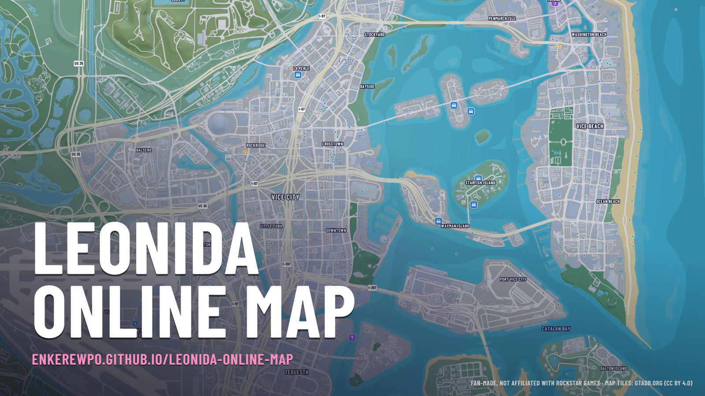
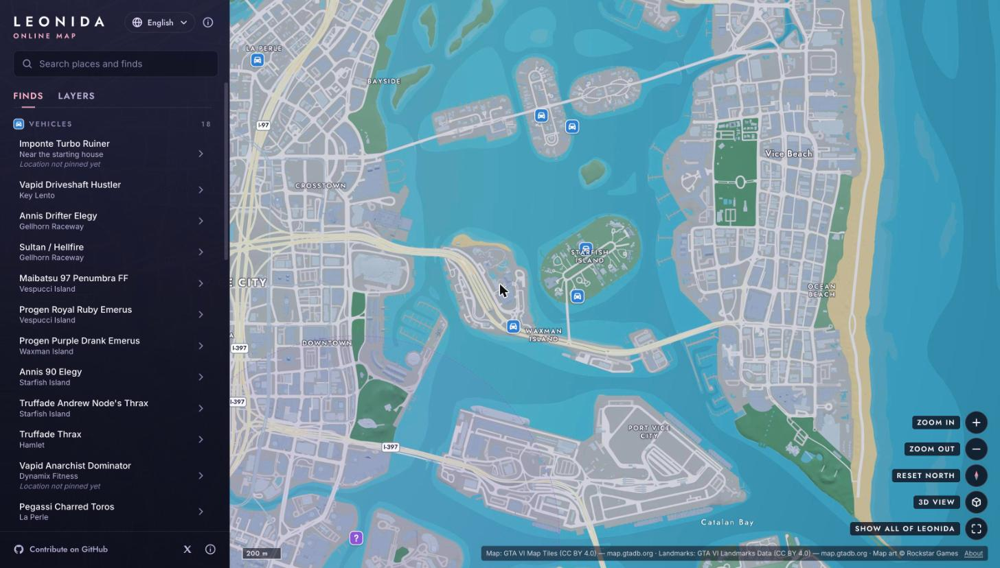

# Leonida Online Map

An unofficial, community-maintained online map of the state of Leonida from Grand Theft Auto VI.
雷奥奈达在线地图：社区共同维护的 GTA VI 地图。

**Live map:** https://enkerewpo.github.io/leonida-online-map/





- The in-game map as the base, zooming level by level like any map app, from the whole state down to single
  buildings.
- On top of it: region and district names, 900+ named landmarks (gas stations, gun shops, clubs, restaurants,
  hotels, police, hospitals…), highway numbers along the roads, and community finds (vehicles, weapons, easter
  eggs, hideouts, freebies, hidden items). Each appears from the zoom where it fits.
- Search any place, filter by legend down to a single category (only gas stations, only clubs…).
- English, 简体中文 and 繁體中文; desktop and phone.
- Right-click (long-press on a phone) anywhere → **Add or fix here** opens a GitHub issue with the spot filled in.

No ads, no analytics, no tracking. No story spoilers.

## Where it comes from

| Layer | Source |
| --- | --- |
| Base map | The in-game map: "GTA VI Map Tiles (CC BY 4.0) — https://map.gtadb.org" ([rolux/gtadb.org](https://github.com/rolux/gtadb.org)). CI fetches the tiles at build time; they are not stored here. |
| `data/places.geojson` | Region and place names read off [Rockstar's official Leonida map](https://www.rockstargames.com/VI/media) |
| `data/landmarks.geojson` | "GTA VI Landmarks Data (CC BY 4.0) — https://map.gtadb.org", plus community additions |
| `data/roads-named.geojson` | Highway numbers from the official map's shields along the in-game highways; street names from the community |
| `data/poi.geojson` | Community finds, each with a source link |
| `tools/i18n/zh-Hans.json` | Chinese names: official where Rockstar or the game has one, otherwise community translations |

## Contributing / 参与

Everything on the map is plain GeoJSON in [`data/`](data). Fix a name, add a shop, draw a street name, correct a
translation — small pull requests are welcome, and CI checks every change.

- English guide: [CONTRIBUTING.md](CONTRIBUTING.md)
- 中文社区手册：[docs/handbook.zh-Hans.md](docs/handbook.zh-Hans.md)
- No code? Use the [issue forms](../../issues/new/choose) (add, fix, remove, translate) or the map's right-click menu.

Every change needs a source someone else can check: your own in-game screenshot or observation, or official
Rockstar material. No leaked or extracted game files, no copied game icons, no spoilers.

## Running it locally

Needs Node.js 22+.

```sh
npm ci
git clone --depth 1 --filter=blob:none --sparse https://github.com/rolux/gtadb.org /tmp/gtadb
git -C /tmp/gtadb sparse-checkout set maps/tiles/6/day
npm run tiles -- /tmp/gtadb/maps/tiles/6/day   # in-game tiles -> public/tiles/day (512 px)
npm run validate                                # check data/*.geojson
npm run dev                                     # http://localhost:5173/leonida-online-map/
npm run build                                   # static site in dist/
```

## Legal

Unofficial fan project. Not affiliated with or endorsed by Rockstar Games or Take-Two Interactive. Grand Theft
Auto and related marks are trademarks of Take-Two Interactive. Map art © Rockstar Games, used for non-commercial
fan purposes and removed on request. The site contains no extracted game files, no ads and no donation links;
icons are our own drawings and fonts are open-source.

## Licences

- Code: MIT, see [LICENSE](LICENSE).
- Data in `data/`: CC BY-NC-SA 4.0 for contributors' work, see [data/LICENSE](data/LICENSE); third-party data keeps
  its own licence (GTADB: CC BY 4.0). Grants no rights in Rockstar's material.
- Fonts (Barlow Condensed, Figtree, Noto Sans SC, Noto Sans TC): SIL Open Font License 1.1, see [fonts/](fonts/).
- MapLibre GL JS: BSD-3-Clause.

Made by [wheatfox](https://x.com/wheat_fox) and contributors.
